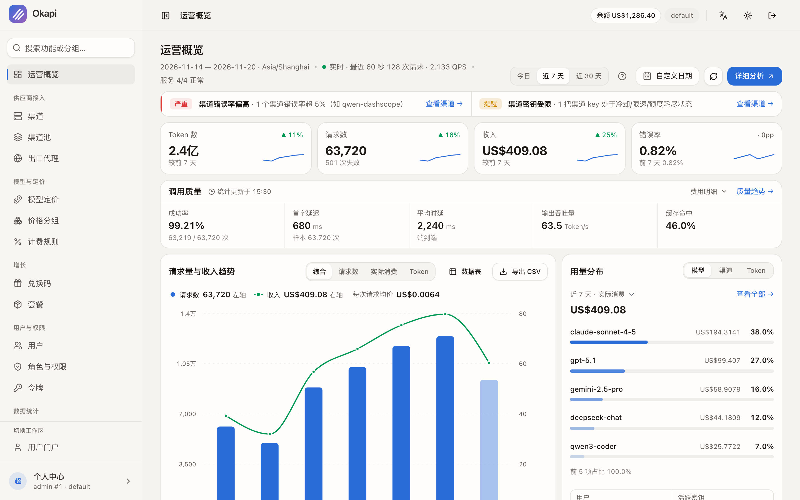
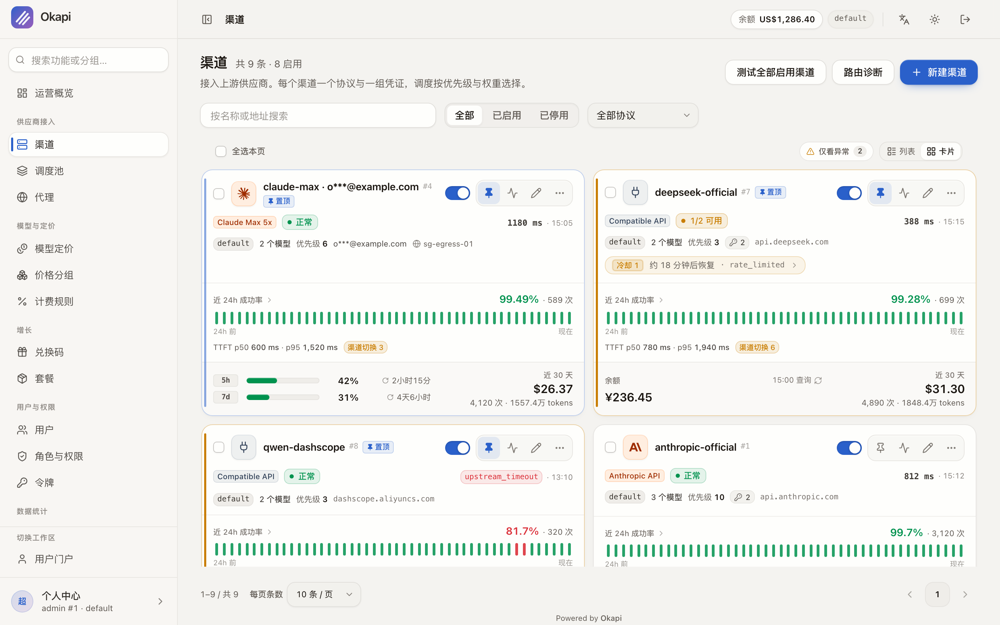
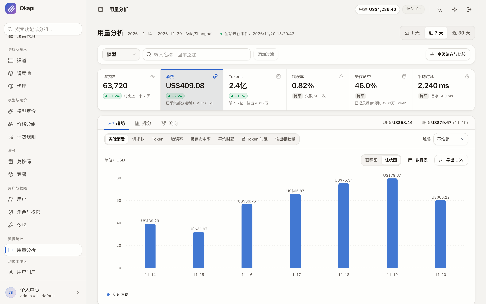
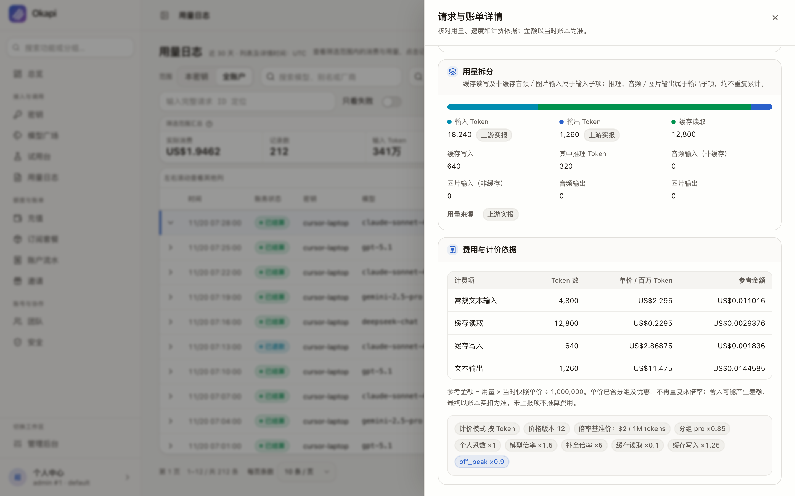
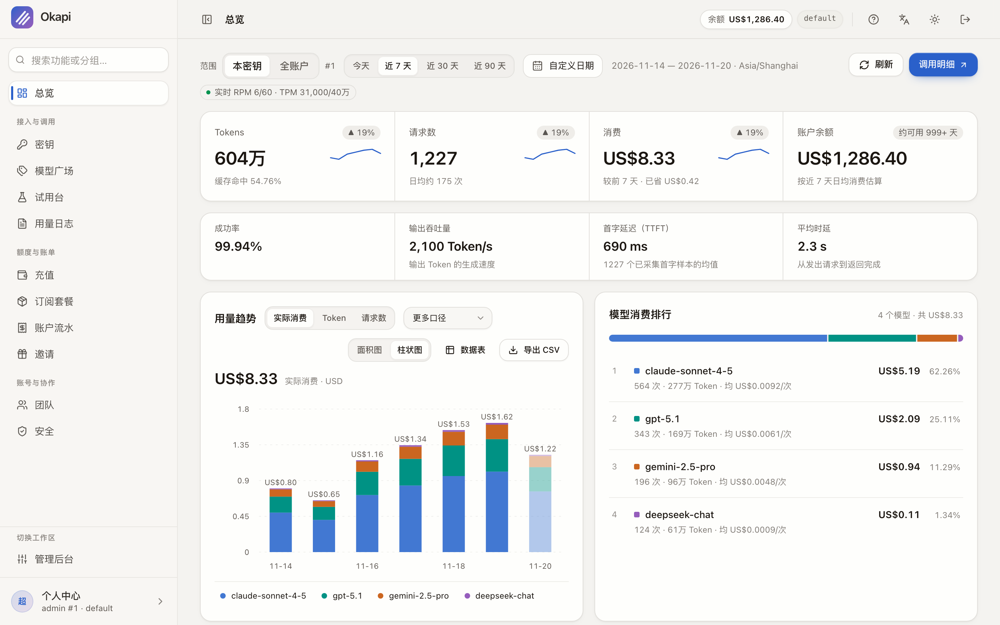
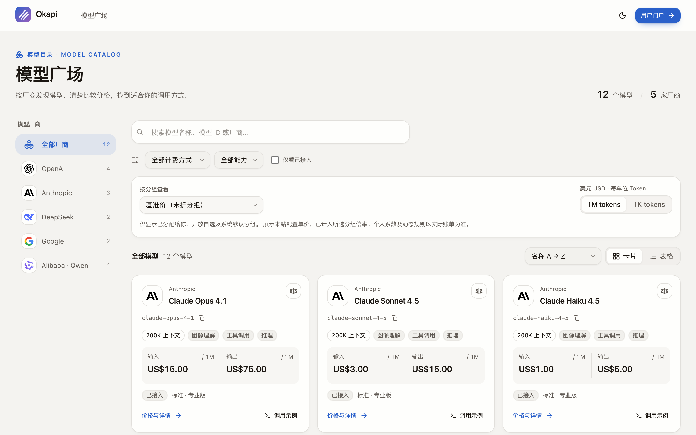
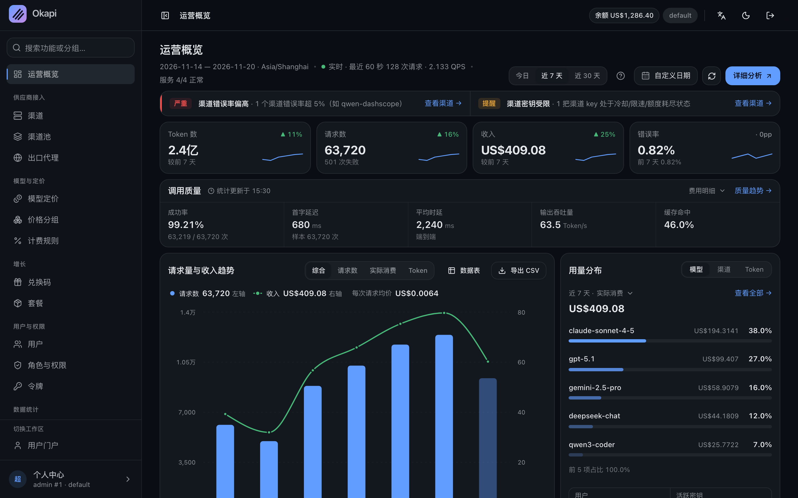
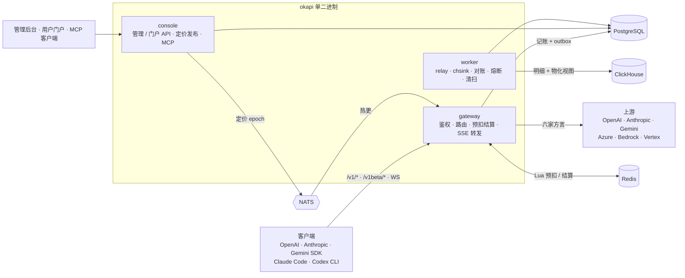

<div align="center">

# Okapi

**自托管的 AI API 网关：一个入口接入多家大模型，按倍率精确计费，每一笔账都能展开成算式。**

Rust 单二进制 · 自带管理后台与用户门户 · OpenAI / Anthropic / Gemini 协议兼容

<sub>A self-hosted AI API gateway written in Rust: one OpenAI / Anthropic / Gemini compatible endpoint in front of many LLM providers, with exact, explainable billing and a built-in admin console.</sub>

[](https://github.com/qiaojinxia/okapi/actions/workflows/ci.yml)
[](LICENSE)

[快速开始](#快速开始) · [界面截图](#界面截图) · [功能清单](#功能清单) · [部署](#部署) · [文档](#文档)

</div>

<picture>
  <source media="(prefers-color-scheme: dark)" srcset="docs/screenshots/admin-dashboard-dark.png">
  
</picture>

## 适合谁

- **运营 API 中转站**：分组定价、充值支付、兑换码、套餐、邀请返利、三方对账，计费后台开箱即用。
- **团队统一出口**：各家 API key 和云厂商账号收到一处，按成员 / 密钥限额，用量与成本按人、按模型、按渠道拆开看。
- **个人自用**：自己的 Claude Pro / Max、ChatGPT Codex 订阅登录成渠道，Claude Code、Codex CLI 直接切到网关（实验性）。

## 快速开始

只需要 Docker。镜像在本机从源码构建，不用装 Rust：

```bash
git clone https://github.com/qiaojinxia/okapi.git && cd okapi
cat > deploy/.env <<EOF
POSTGRES_PASSWORD=$(openssl rand -hex 16)
CLICKHOUSE_PASSWORD=$(openssl rand -hex 16)
OKAPI_MASTER_KEY=$(openssl rand -hex 32)
OKAPI_SETUP_TOKEN=$(openssl rand -hex 16)
EOF
docker compose --env-file deploy/.env -f deploy/docker-compose.yml --profile single up -d --build
```

首次构建要编译 Rust 和 BoringSSL，视机器需要 15–40 分钟。起来之后：

1. 打开控制台 <http://127.0.0.1:8081>，按向导创建超管（需要填 `deploy/.env` 里的 `OKAPI_SETUP_TOKEN`）。
2. 在「渠道」里接入上游（填 API key，或用 OAuth 登录订阅账号）；在「模型定价」里给模型定价，点「发布定价」生效。
3. 在门户「密钥」页新建一把 key，把客户端的 base URL 换成网关地址：

```bash
curl http://127.0.0.1:8080/v1/chat/completions \
  -H "Authorization: Bearer <你的 key>" -H "content-type: application/json" \
  -d '{"model":"gpt-5.1","messages":[{"role":"user","content":"hello"}]}'
```

网关（8080）对外，控制台（8081）只绑本机。上公网前请先看[部署](#部署)里的反代与信任来源说明。

## 界面截图

<table>
  <tr>
    <td width="50%" valign="top">
      
      <p><b>渠道</b>：多家上游集中管理，测活结果、上游余额、订阅额度窗口、密钥冷却都在一行里。</p>
    </td>
    <td width="50%" valign="top">
      
      <p><b>用量分析</b>：趋势 / 拆分 / 流向三视图，按模型、渠道、用户、密钥任意过滤与比较。</p>
    </td>
  </tr>
  <tr>
    <td valign="top">
      
      <p><b>账单解释</b>：任意一笔请求展开成「用量 × 当时快照单价」的逐项算式，附分组、规则等倍率快照。</p>
    </td>
    <td valign="top">
      
      <p><b>用户门户</b>：用户自己的用量趋势、模型消费排行、实时 RPM / TPM 与余额。</p>
    </td>
  </tr>
  <tr>
    <td valign="top">
      
      <p><b>模型广场</b>：公开价格页，按厂商、能力、分组比价，每个模型附调用示例。</p>
    </td>
    <td valign="top">
      
      <p><b>深色主题</b>：全站支持浅色 / 深色主题，界面有简体中文与英文。</p>
    </td>
  </tr>
</table>

<sub>截图里是虚构的演示数据，由 <code>frontend/e2e/readme-shots.spec.ts</code> 生成：在 <code>frontend/</code> 下执行 <code>pnpm build && pnpm exec playwright test -c playwright.readme.config.ts</code>。</sub>

## 为什么是 Okapi

- **每一分钱可解释。** 金额全程 i64 micro-USD 定点，计费路径禁浮点（CI 守卫拦截）；每笔账落一份可回放的
  `pricing_snapshot`；门户里任意一笔账单能展开成逐步算式，管理员改价前有定价模拟器预览新旧差异。
- **一个入口，四种协议互转。** 入口 OpenAI / Anthropic `/v1/messages` / Gemini / Responses，上游 OpenAI /
  Anthropic / Gemini / Azure / Bedrock / Vertex 任意组合；`reasoning_effort`、`thinking`、`reasoning:{…}`
  三种写法归一成一条内部指令再按渠道方言展开——客户端不必知道这次会路由到哪家。
- **账目安全到多副本。** Redis Lua 原子预扣 → 上游调用 → usage 结算 → PG 事件溯源 + outbox；失败原额退款；
  三方对账（事件重放 ↔ Redis 热余额 ↔ PG 快照）并可按账本修复；采集上游成本算毛利，负毛利自动熔断。
- **自用订阅凭证也能进网关。** 站长自己的 Claude Pro / Max、ChatGPT Codex 订阅经 OAuth 登录成渠道，
  token 刷新走四步锁；Claude Code / Codex CLI 直接切到网关（实验性）。
- **调度可编排，上游可验真。** 每个调度池一份带版本的策略文档（多跳降级、条件规则、灰度、护栏），
  改之前先 Dry-Run 对比新旧选路；订阅账号按 5 小时 / 7 天额度窗口排先后，快过期的额度先用掉；
  渠道背后是不是声称的模型，可以从协议、分词器、行为指纹三层核验。
- **AI 直接管网关。** console 内置 MCP 服务（Streamable HTTP），22 个工具按 RBAC 裁剪；写操作过三道闸
  （站点总开关 + 权限点 + dry-run / confirm）。
- **单二进制，热路径干净。** `okapi gateway|console|worker|all` 一个二进制跑任意组合；gateway 只碰
  Redis 与上游，零跨服务调用。容器 8 vCPU 压测 json 10874 / stream 10402 RPS 全 0 错误，SSE 2 万条持有
  120s 无泄漏。

## 架构一图



## 功能清单

已实现的打勾；未打勾的是明确列入待办、尚未落地的项。逐项验收记录见
[IMPLEMENTATION.md](IMPLEMENTATION.md) §11 / §13，自动化用例覆盖见
[docs/verification-checklist.md](docs/verification-checklist.md)。

<details>
<summary><b>数据面：入口协议</b>（10 项，待办 1）</summary>

- [x] `/v1/chat/completions` 流式 + 非流式，SSE 首字前缓冲与 failover
- [x] Anthropic `/v1/messages` 原生入口（+ `count_tokens`，x-api-key 鉴权，错误壳对齐）
- [x] Gemini `/v1beta/models/{model}:generateContent | streamGenerateContent` 原生入口（Bearer / `x-goog-api-key` / `?key=`）
- [x] `/v1/responses` 原生直转（保住 previous_response_id / 内置工具 / reasoning）+ 自动降级 ChatCompletions
- [x] `/v1/embeddings`、`/v1/rerank`（Jina / Cohere 形状）
- [x] `/v1/images/generations | edits`（per_call × n）、`/v1/audio/speech | transcriptions | translations`
- [x] `/v1/videos` 提交 / 轮询 / 下载（per_call × seconds，任务按用户隔离，上游失败退款）
- [x] OpenAI Realtime WebSocket 桥接（per-key 连接租约，断开时按累计 usage 结算）
- [x] `/pass/{channel_id}/*` 自定义透传（路径前缀白名单 + 按次计费，禁零费裸透传）
- [x] `/v1/models`、new-api 兼容余额端点 `/v1/dashboard/billing/*`
- [ ] 图片 variations；任务型异步中转（Midjourney / Suno 形态）

</details>

<details>
<summary><b>上游供应商</b>（10 项，待办 1）</summary>

- [x] OpenAI / OpenAI 兼容、Anthropic、Gemini、Azure OpenAI（部署名映射）
- [x] AWS Bedrock（SigV4 或 Bedrock API key，EventStream 流解码）
- [x] Google Vertex AI（服务账号 JWT 换 token；Claude rawPredict、Gemini generateContent）
- [x] Claude Pro / Max、ChatGPT Codex 订阅凭证 OAuth 登录成渠道（实验性，只路由 chat 族）
- [x] 出口代理：代理 / 代理组为一等资源，渠道按继承 / 直连 / 单个代理 / 代理组出站；一号一 IP 固定分配、后台探测、被动熔断、全局默认出口
- [x] 渠道自定义请求头；请求字段剥离 / 注入；上游响应头白名单
- [x] 上游模型发现（fetch-models）、上游余额查询、上游倍率在线同步（fetch / apply，不自动改价）
- [x] 渠道凭证 AES-GCM 信封加密、上游 URL SSRF 校验
- [x] 一个渠道挂多把 key：逐把增删、单独设上限、单独清冷却；批量设池 / 批量清冷却
- [x] 渠道模型验真：协议与能力探针、分词器指纹（开集贝叶斯）、行为指纹归因三层核验，结果逐层给结论；请求走正常数据面（出口代理照常生效），行为指纹参考库按需下载，也可用 `OKAPI_MODEL_VERIFY_DIR` 指向离线目录
- [ ] Bedrock 非 Anthropic 模型（Converse 转换）

</details>

<details>
<summary><b>reasoning 与模型修饰符</b>（5 项）</summary>

- [x] `reasoning_effort` / `thinking` / `reasoning:{effort,max_tokens}` 三写法归一，按 openai / anthropic / gemini 方言展开
- [x] 模型名修饰符 `模型名@effort:high`、`-thinking-128` 后缀，变体可单独定价
- [x] thinking-to-content（客户端不支持 reasoning 输出时转正文）
- [x] 按上游实际响应模型计费、service_tier 档位倍率（只降不升）
- [x] 跨协议转换保留 `cache_control` 断点与 reasoning 强度 / `thinkingConfig`；转不过去的字段记进请求诊断（`dropped_fields`）

</details>

<details>
<summary><b>路由与容错</b>（15 项）</summary>

- [x] 调度池六种选路策略：优先级加权、最低时延、最少用量、最少并发、最早重置、过期紧迫度；能力感知过滤，成本感知权重
- [x] 调度策略中心：每个池一份带版本号的策略文档——多跳降级链、按模型 / 上下文长度的条件规则、硬护栏、灰度成员按会话分桶，成员分主 / 备 / 灰度角色并可单独摘流；保存前可 Dry-Run，对比已保存与草稿策略的选路结果
- [x] 订阅额度窗口调度（`expiry_urgency`）：综合 5 小时 / 7 天两个窗口的剩余额度与剩余时间，先用掉快过期作废的额度；大上下文请求避开快见底的账号
- [x] 低质量自动降级（按池开启，缺省关）：key 的错误率 / 时延超阈值就排到同层健康 key 之后；另设了摘流阈值时，错误率更高的直接摘掉（全员超限时保底不摘空）
- [x] 三层会话粘性（按模型隔离，辅助小模型请求不抢主对话的缓存账号；没有会话 ID 时按 system / tools 前缀归桶）、双层并发控制、重试矩阵（全局缺省 + 渠道级覆盖）
- [x] 上游错误跨协议归一分类；模型级短冷却（某个模型没开通 / 地区受限只冷却这把 key 上的这个模型）；529 过载指数退避（15 秒起，最长 5 分钟）
- [x] key 级状态机（冷却 / 限流 / 配额耗尽 / 失效）与冷却到期自动恢复
- [x] 渠道 key 后台探测与自动恢复（缺省关；探通的 key 放回轮转，只探静态 key 的直连渠道，人工停用的不碰）
- [x] 请求策略可配：最大尝试次数、追加的重试状态码、追加的凭证失效 / 配额耗尽判定（状态码与错误正文关键词），缺省保持内置行为
- [x] 渠道上游余额定时刷新：回填渠道列表；渠道设阈值后低余额发通知，可选自动停用，余额回来再自动启用（只启用自己停的），缺省关
- [x] Gemini 工具参数 schema 清洗（additionalProperties / $ref / 类型数组 / 非字符串 enum 等不再让请求 400）；Anthropic API key 渠道转发客户端的 anthropic-beta，上游点名拒收时自愈
- [x] 首字前跨渠道 failover；首字后同渠道换 key 重试，不串流
- [x] 请求级路由偏好（OpenRouter 形状）、路由诊断器
- [x] 结算积压背压闸（超上界 503，不预扣不打上游）、优雅下线（SIGTERM 排水后再退出）、后台任务统一监管（panic 后退避重启）
- [x] 多副本一致：在途计数汇总、路由失效广播、定价 epoch 热更；周期任务走 Redis 维护租约（同一时刻只有一个副本在跑）；NATS 订阅断线自愈并补拉；key / 代理故障标记跨副本同步

</details>

<details>
<summary><b>计费与账本</b>（12 项，待办 1）</summary>

- [x] 三种计价模式（倍率 / 阶梯 / 按次）× 分组倍率 × 用户系数
- [x] 四类修饰器规则（量级 / 时段 / 折扣 / 负载加价），每步落快照
- [x] 缓存读 / 写双轴、音频 token 独立倍率、媒体乘数
- [x] Redis Lua 原子预扣 → usage 结算 → PG 同事务记账 + outbox
- [x] 结算微批组提交：2 毫秒窗口内最多 64 笔普通结算合成一次 PG 事务；个别被锁住的用户退回单笔路径，不拖累同批
- [x] 失败原额退款、按日志退款 / 调整打标、`request_id` 幂等
- [x] 三方对账 + 按账本修复热余额；DLQ 处置
- [x] 上游成本采集与毛利、负毛利自动熔断（可手动解除）
- [x] 订阅套餐（周期配额池，订阅池优先）、余额有效期、邀请返利
- [x] 限流四件套：分组级 `[rpm, rph]`、key 级 RPD / 日 token 上限、用户×模型 RPM、无效 key 每 IP 限流
- [x] 密钥周期预算：每把 key 可设日 / 月消费上限（按 UTC 自然日 / 自然月）
- [x] 用户专属价：按用户 × 模型覆盖倍率或绝对单价，可设到期时间；模型别名
- [ ] `reserve` 侧 Redis 缺键回源兜底

</details>

<details>
<summary><b>用户、身份与安全</b>（12 项，待办 1）</summary>

- [x] 邮箱密码（argon2id）+ 邮件验证码 / 找回密码（SMTP）
- [x] GitHub / Discord / LinuxDO 预设 + 任意标准 OAuth2 / OIDC 自定义接入
- [x] TOTP 两步验证、Turnstile 注册风控、注册策略与邀请赠送
- [x] web 会话列举 / 单条吊销 / 一键全吊 / 会话数上限；网页登录换到的 key 绑定会话，会话结束即失效；控制台走 HttpOnly 会话 Cookie，写操作校验同源（CSRF）
- [x] RBAC 权限点 + 三内置角色 + 自定义角色；渠道属主 own / all；分组可见性矩阵；代客操作
- [x] Team 层（成员限额、分账、团队 key）
- [x] key 级 IP 白名单、模型白名单（支持 `claude-*` 这类通配，填别名自动归一到真名）+ 转发头信任闸（信任代理 CIDR / Edge key 两模式）
- [x] 门户自助：密钥一键轮换（原子换新）、自己把密钥限流调紧（只能调紧不能调松）、低余额 / 密钥到期提醒（邮件或 webhook，可设最短间隔）
- [x] 对话存档（缺省关，在「系统设置 → 隐私与留痕」开启）：保存请求与响应原文，有 ClickHouse 存 ClickHouse、没有就存 PG；单侧截断上限与保留天数可配，到期自动清理；可选让用户在门户看自己的存档
- [x] 关键接口每 IP 限流（登录 / 注册 / TOTP / 兑换）
- [x] 审计日志与登录审计
- [x] 单用户模式（release 下需二次确认）
- [ ] Telegram 登录、LDAP；内容记录三态

</details>

<details>
<summary><b>运营与控制面</b>（9 项）</summary>

- [x] 渠道 / 池 / 模型 / 定价 / 规则 / 分组 / 用户 / 套餐 / 兑换码 / 团队 / 角色 / 模型别名 / 用户专属价 全量 CRUD
- [x] 定价 epoch 发布 + NATS 广播热更；历史版本任意两版对比、一键回滚、发布前模拟；new-api 倍率 JSON 一键导入
- [x] 支付闭环：epay（支付宝 / 微信）+ Stripe Checkout，回调验签与幂等
- [x] 兑换码（限用户 / 限 IP / 兑套餐，并发核销恰一成功）、站点公告
- [x] 通知多路（webhook / email）× 事件订阅 × 频率限制
- [x] 用量分析立方体（ClickHouse）：趋势 / 拆解 / 流向三视图，质量看板，经营报表
- [x] 统计时区在后台设置（「系统设置 → 时区」）：整小时时差的 IANA 时区，切换即时生效、不用重启；不设就跟随服务器时区
- [x] 可观测：gateway / console 暴露 Prometheus `/metrics`，W3C `traceparent` 贯穿请求诊断与 NATS；监控页汇总各节点指标与 24 小时网关趋势
- [x] 日志检索、对账页、缓存清理、Setup 初始化向导

</details>

<details>
<summary><b>MCP（AI 远程管理）</b>（3 项）</summary>

- [x] Streamable HTTP，协议 `2025-06-18`，Bearer key 鉴权
- [x] 22 个精选工具按调用方 RBAC 过滤：普通用户 5 个只读，超管全量
- [x] 写工具三道闸：站点级总开关（缺省关）+ `mcp.write` 权限点 + dry-run / confirm 两段式

</details>

<details>
<summary><b>前端</b>（6 项）</summary>

- [x] 管理后台 + 用户门户 + 公开价格页同一 SPA，按角色分区
- [x] 渠道列表：每一格都能点进对应操作（测活、请求日志、限额、调度池、模型、代理、余额刷新），只看异常、置顶、卡片视图与 24 小时成功率条
- [x] 账单解释器、定价模拟器、Playground 试用台（控制面同源中继）
- [x] 新手引导与接入指南；密钥一键导入 Claude Code / Codex（cc-switch）、NextChat、Cherry Studio
- [x] i18n zh-CN / en（守卫零裸文案、中英键对齐）、暗色主题、响应式
- [x] Playwright e2e：冒烟（真实 console）+ 交互（接口桩）

</details>

<details>
<summary><b>部署与迁移</b>（5 项，待办 1）</summary>

- [x] 单二进制多角色，前端产物 `embed-web` 嵌入
- [x] console 可单独部署：配 `OKAPI_GATEWAY_INTERNAL_URL` 后试用台、渠道测试经 HTTP 数据面桥接调用远端 gateway（渠道指定用 30 秒有效的 HMAC 签名头，验不过就拒）
- [x] Docker Compose 单机 / 多角色双 profile，K8s manifests（gateway HPA），Nginx SSE 反代模板
- [x] `okapi migrate newapi` / `okapi migrate okapi-old` 双源迁移（幂等、dry-run）
- [x] 压测：容器 8 vCPU json 10874 / stream 10402 RPS 全 0 错误
- [ ] 裸金属正式压测

</details>

明确不做：长尾供应商专属渠道（OpenAI 兼容通道覆盖）、订阅账号池转售、后台一键自升级、
沙盒插件运行时、内置敏感词中间件（交前置 WAF / 审核 API）。

## 本地开发

编译需要 cmake、clang 与 git（Claude Code 渠道的 TLS 握手用 BoringSSL，随构建从源码编译）：
macOS `brew install cmake`，Debian/Ubuntu `apt install cmake make clang libclang-dev git`。

```bash
bash scripts/dev-deps.sh up     # 起 PG + Redis + CH + NATS 开发容器（不在本机装服务）
cp .env.example .env            # sqlx 编译期校验与运行时共用
bash scripts/dev-reset.sh       # 重建库 + 灌演示数据（改了已应用的迁移后必跑；新增迁移启动时自动应用）
cargo run --bin okapi -- all    # 单进程跑齐三角色
```

控制台 http://127.0.0.1:8081（`dev-reset.sh` 会打印演示超管账号与管理 key），网关 http://127.0.0.1:8080。
改前端要热更新的话，`cd frontend && pnpm dev`，vite 会把 API 代理到 8081。

验证：

```bash
cargo test --workspace                                   # 全量用例（依赖上面的开发容器）
cargo clippy --workspace --all-targets -- -D warnings
bash scripts/guard-no-float.sh                           # 计费红线：禁浮点/禁 panic
bash scripts/guard-i18n.sh && python3 scripts/guard-i18n-keys.py   # 前端文案守卫
python3 scripts/guard-query-keys.py                      # 前端 query key 只从 qk 工厂取
cd frontend && pnpm build && npx playwright test smoke   # 前端构建 + e2e 冒烟
```

分层执行入口（静态守卫 → 单元 → 集成 → e2e → 部署形态 → 性能）见 [docs/verification-checklist.md](docs/verification-checklist.md)。

## 部署

```bash
docker compose --env-file deploy/.env -f deploy/docker-compose.yml --profile single up -d   # 单机（okapi all）
docker compose --env-file deploy/.env -f deploy/docker-compose.yml --profile multi  up -d   # 多角色
kubectl apply -f deploy/k8s/okapi.yaml                                # K8s（gateway 带 HPA）
```

`deploy/nginx-sse.conf` 是前置反代模板（SSE 不缓冲、长超时、来源 IP 头归一化）。

**`/metrics` 别经反代对外。** gateway 与 console 的 Prometheus `/metrics` 在没配 `OKAPI_METRICS_TOKEN` 时
只按 socket 对端判定：回环 / 内网地址放行。反代和 okapi 在同一台机器或同一私网时，对端永远是内网地址，
经反代转发的公网请求也会被放行。上公网前在反代里屏蔽 `/metrics`，或者设 `OKAPI_METRICS_TOKEN`，设了以后只认
`Authorization: Bearer <token>`。`deploy/docker-compose.yml` 的环境变量清单里默认没有这一项，要用就自己加上。

**横向扩展前必须核三件事**：

1. **连接数**。每个 pod 各开一套 PG 池，总连接 = Σ(副本数 × `OKAPI_PG_POOL`)；`all` 单进程模式里
   gateway / console / worker 三个角色各开一套，一个进程就占 3 × `OKAPI_PG_POOL`。
   走缺省 16 时 gateway 10 + console 2 + worker 1 就是 208 条，而 PG 缺省
   `max_connections=100`——扩到一半开始耗尽，且现象是 acquire 超时而非"连不上"。
   manifest 里已按副本上限配死（12 / 8 / 16），改 HPA 上限时记得一起改。
2. **信任来源**。不配 `OKAPI_TRUSTED_PROXIES`，转发头一律不作数（只认 socket 对端），
   `client_ip` 会变成 Ingress 的地址、key 级 IP 白名单会误拒。容器里反代与网关不同 IP，
   必须显式配网段或用 `OKAPI_EDGE_KEY`。K8s 模板走后者（集群内任何 pod 都在私网段里，
   整段放行等于谁都能伪造来源 IP）：在 `okapi-env` 里设 `OKAPI_EDGE_KEY`，Ingress 回源注入
   同值的 `X-Okapi-Edge-Key` 头。信任一台自己的反代（不是 CDN）时，那台反代还得清掉或重设
   `True-Client-IP` / `CF-Connecting-IP` / `X-Real-IP`——网关在可信来源下先读这三个头、再看
   `X-Forwarded-For`，它们调用方可写；`deploy/nginx-sse.conf` 已经处理，换成别的反代要照做。
3. **时区一致**。时段折扣的分钟窗与星期按进程本地时区判定（`TZ` 环境变量），所有副本必须设同一个
   `TZ`，否则同一请求落到不同副本会按不同价计费。统计页的"今天 / 本月"和渠道额度上限的日 / 周 / 月窗口
   按后台「系统设置 → 时区」切分，没设时跟随 `TZ`。key 用量限额与密钥日 / 月预算固定按 UTC 自然日 /
   自然月重置，与这两者都无关——对账时注意口径。

worker 单副本就够。周期任务（对账 / 清扫 / 分区 / 冷却恢复等）走 Redis 维护租约，多副本时同一时刻只有一个
副本在跑，多开只是多一份接替。chsink 吞吐不够时可以加副本（relay / chsink 走 `SKIP LOCKED` + JetStream
durable，可以并行）。
气隙或只读部署可用 `OKAPI_WORKER_DISABLE` 关掉只观测 / 只外联的任务（`egress_probe`、`ops_sampler`、`unit_calibration`）。

主要环境变量见 [.env.example](.env.example)，每项都带了"为什么要有它"的注释。

## MCP 接入

console 角色内置 MCP 服务（Streamable HTTP，协议 `2025-06-18`），可直接挂到任意 MCP 客户端：

```bash
claude mcp add --transport http okapi http://127.0.0.1:8081/mcp \
  --header "Authorization: Bearer <你的 API key>"
```

key 要用门户「密钥」页新建的普通 key：网页登录换到的 key 绑定浏览器会话，在外部客户端里无效。

工具按调用方的 RBAC 权限点过滤：普通用户 key 看到 5 个只读工具（余额 / 用量 / 密钥 /
价目 / 账单解释），超管看到 22 个（含平台 KPI、渠道健康、日志检索、对账、DLQ、全链路诊断、
建渠道 / 调余额 / 改价等写操作）。

写工具走三道闸：站点级 `mcp_write_enabled` 总开关（**缺省关**）+ `mcp.write` 权限点 +
dry-run/confirm 两段式。总开关关闭时，写工具既不出现在 `tools/list`，直接调用也会被拒。

## 文档

| 文档 | 内容 |
| --- | --- |
| [DESIGN.md](DESIGN.md) | 调研结论、倍率计费模型 v3、前端设计 |
| [IMPLEMENTATION.md](IMPLEMENTATION.md) | 选型定案、架构、里程碑与逐项验收（§11 是改动流水账） |
| [docs/database.md](docs/database.md) | 存储层唯一权威（PG / Redis / ClickHouse / NATS） |
| [docs/verification-checklist.md](docs/verification-checklist.md) | 模块 × 维度覆盖矩阵、分层执行入口与执行记录 |
| [docs/perf-report.md](docs/perf-report.md) | 压测方法与结论 |

## 工作区布局

```
crates/
  okapi-domain     # 领域基元：金额（i64 micro-USD）/ tokens / 计费状态机
  okapi-pricing    # PriceBook 编译器 + 修饰器栈 + ArcSwap 热更
  okapi-ledger     # Redis Lua 预扣/结算 + PG 事件溯源 + outbox
  okapi-providers  # Provider trait + 按方向拆的协议转换 + Bedrock / Vertex / OAuth
  okapi-store      # sqlx / fred / clickhouse / async-nats 薄封装
  okapi-api        # OpenAI 兼容 DTO + 错误码 + 权限点清单
  okapi-kernel     # 各角色共用的底层：配置、鉴权、调度 Redis、对账与修复
  okapi-engine     # 共享运行时：AppState、凭证与账号控制、选路缓存、异步媒体执行器
  okapi-gateway    # 数据面：鉴权准入、预扣 / 结算、选路、上游转发与流式
  okapi-console    # 控制面：管理后台与用户门户 API、MCP
  okapi-worker     # 异步面：结算补写、统计落库、对账告警、到期与分区维护
bins/okapi         # 单二进制多角色入口：okapi gateway|console|worker|all|migrate|seal-credentials
frontend/          # React 19 SPA（管理后台 + 用户门户 + 公开价格页）
```

## 许可证

Copyright (C) 2026 The Okapi Developers

以 [GNU Affero General Public License v3.0](LICENSE)（AGPL-3.0-only）开源：可以免费使用、修改和商用；分发本项目
（含修改版）须沿用 AGPL-3.0 并提供源码；修改后以网络服务形式对外提供（例如运营中转站），须向该服务的使用者
提供修改后的完整源码。

依 AGPL-3.0 第 7 条附加以下条款（以英文为准）：

> Additional terms under AGPLv3 Section 7 apply. Modified versions must preserve the attribution notice
> `Powered by Okapi` in the appropriate legal notices and in any prominent about, legal, footer, or
> attribution location presented by the user interface (as shipped: the bottom of every admin console
> and user portal page, and the footers of the sign-in pages and the public pricing page). Modified
> versions that present a user interface must also keep that notice linked to the original project:
> <https://github.com/qiaojinxia/okapi>.

如果所在组织的政策不允许使用 AGPL-3.0 软件，或希望免除 AGPL-3.0 的开源义务，请发邮件至
[qiaojinxia77@gmail.com](mailto:qiaojinxia77@gmail.com) 商谈商业授权。

`frontend/public/vendor-icons/` 下的供应商图标来自 [LobeHub Icons](https://github.com/lobehub/lobe-icons)，
按其 MIT 许可证分发（见该目录下的 LICENSE）。渠道模型验真的分词器指纹算法与
`crates/okapi-engine/src/model_verify/tokenizer_bank.json` 来自 [Ikaleio/lm-detector](https://github.com/Ikaleio/lm-detector)，
行为指纹打分器是 crates.io 上的 [lmfpd](https://crates.io/crates/lmfpd)，两者都是 MIT 许可证。
